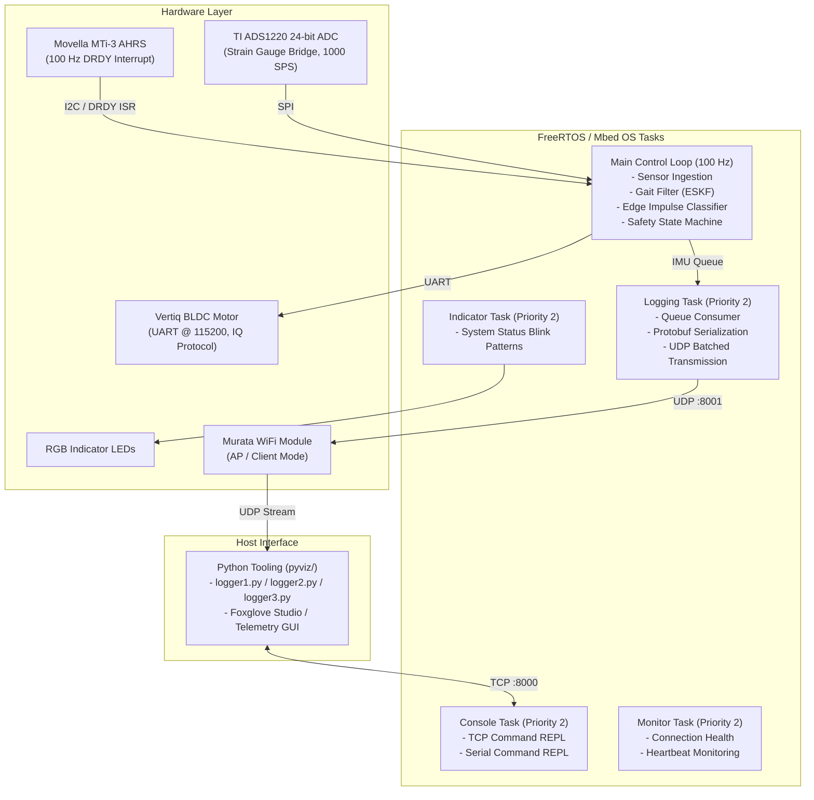
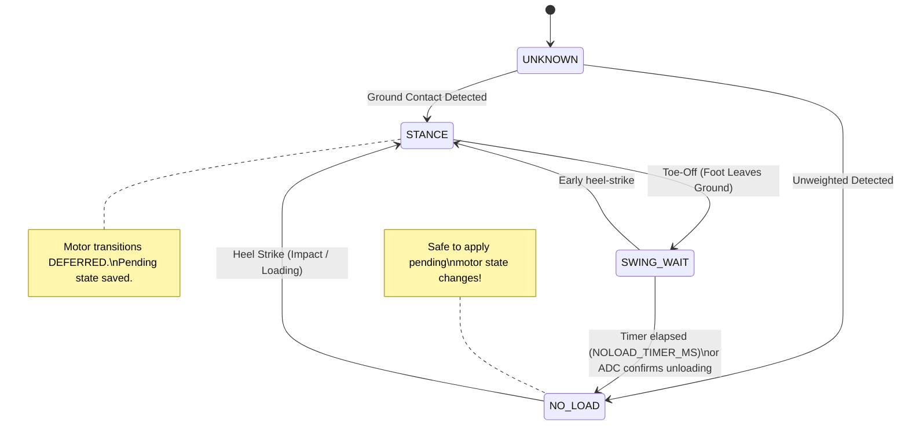

# Folia Embedded Firmware

Firmware for the **Folia Smart Prosthetic Ankle** system running on the **Arduino Portenta H7** (dual-core STM32H747XI, ARM Cortex-M7 @ 480 MHz). The firmware integrates high-speed sensor acquisition, real-time Error-State Kalman Filtering (ESKF), continuous on-device Edge Impulse machine learning inference for terrain classification, safe closed-loop motor actuation, and high-throughput wireless telemetry.

---

## Table of Contents
1. [System Architecture](#system-architecture)
2. [Directory and File Structure](#directory-and-file-structure)
3. [Gait Filter (Kalman-Type Filter)](#gait-filter-kalman-type-filter)
   - [Filter Design & State Representation](#filter-design--state-representation)
   - [Prediction Step (100 Hz)](#prediction-step-100-hz)
   - [Zero-Velocity Updates (ZUPT) & Pivot Constraint](#zero-velocity-updates-zupt--pivot-constraint)
   - [Stance & Foot-Flat Detection Suite](#stance--foot-flat-detection-suite)
   - [Sagittal-Plane Alignment & Walking Direction](#sagittal-plane-alignment--walking-direction)
   - [Step-Relative Resets](#step-relative-resets)
4. [Data Collection & Operational Modes](#data-collection--operational-modes)
   - [Operational Modes Summary](#operational-modes-summary)
   - [Protobuf Telemetry Pipeline](#protobuf-telemetry-pipeline)
   - [Network Architecture (UDP Streaming & TCP Console)](#network-architecture-udp-streaming--tcp-console)
5. [Edge Impulse Classifier Deployment](#edge-impulse-classifier-deployment)
   - [Model Pipeline & Feature Slicing](#model-pipeline--feature-slicing)
   - [Continuous Streaming Inference (20 Hz)](#continuous-streaming-inference-20-hz)
   - [Prediction Stabilization & Debouncing](#prediction-stabilization--debouncing)
   - [No-Load Safety State Machine](#no-load-safety-state-machine)
   - [Model Export & Integration Workflow](#model-export--integration-workflow)
6. [Interactive Console Commands](#interactive-console-commands)
7. [Building and Flashing](#building-and-flashing)

---

## System Architecture



---

## Directory and File Structure

```
embedded/
├── docs/                               # Detailed technical guides
│   ├── edge_impulse_data_format.md     # Protocol buffer schemas and dataset specs
│   └── edge_impulse_deployment.md      # Step-by-step model training and export guide
├── lib/                                # Core libraries and peripheral drivers
│   ├── ads1220_driver/                 # Texas Instruments ADS1220 24-bit ADC SPI driver
│   │   ├── include/ads1220.hpp         # Register maps, configuration, PGA & gain methods
│   │   └── src/ads1220.cpp             # SPI transfer, baseline calibration, tare logic
│   ├── ei_model/                       # Exported Edge Impulse C++ model package
│   │   ├── edge-impulse-sdk/           # DSP algorithms, CMSIS-NN, and TF-Lite Micro runtime
│   │   ├── model-parameters/           # Metadata, feature definitions, thresholds
│   │   └── tflite-model/               # Compiled model tensors and operator definitions
│   ├── gait_filter/                    # 9D Error-State Kalman Filter & gait phase estimator
│   │   ├── include/
│   │   │   ├── gait_filter.hpp         # GaitFilter class declaration
│   │   │   ├── gait_filter_types.hpp   # Vector/Matrix types, state vectors, parameters
│   │   │   └── gait_filter_integration.hpp # Convenience integration helpers
│   │   ├── src/gait_filter.cpp         # ESKF prediction, ZUPT, SHOE, and sagittal math
│   │   └── README.md                   # Detailed algorithmic derivation & tuning notes
│   └── hal_library/                    # Hardware Abstraction Layer & MTi communication
│       ├── include/
│       │   ├── hal.hpp                 # Cross-platform RTOS tasks, events, queues, sleep
│       │   ├── mti.hpp                 # High-level Xsens MTi-3 AHRS wrapper
│       │   └── xbus.hpp                # Low-level Xbus packet parser & framing
│       └── src/
│           ├── hal_mbed.cpp            # Mbed OS / FreeRTOS primitives
│           ├── mti.cpp                 # Sensor configuration, modes, and data parsing
│           └── xbus_i2c.cpp            # I2C driver for Xbus protocol
├── src/                                # Primary firmware application source
│   ├── app/
│   │   ├── app_context.hpp             # Global AppContext (queues, peripheral handles)
│   │   ├── control.hpp / control.cpp   # Operational mode logic, debouncing, safety FSM
│   │   ├── ei_classifier.hpp / .cpp    # Edge Impulse continuous streaming wrapper
│   │   ├── flags.hpp                   # Compile-time switches and debug settings
│   │   ├── imu_packet.hpp              # IMUPacketSlot buffer wrapper
│   │   ├── indicator.hpp / .cpp        # LED blink patterns and diagnostic status
│   │   ├── main.cpp                    # Setup entrypoint, ISR handlers, and 100 Hz loop
│   │   ├── main_prelude.hpp            # Hardware pin mappings, network ports, constants
│   │   ├── network.hpp / network.cpp   # UDP streaming task, TCP REPL console task, WiFi
│   │   ├── util.hpp / util.cpp         # Pitch computation and standing offset calibration
│   │   └── vertiq_motor.hpp / .cpp     # IQ Module protocol client and command queue
│   └── timed.hpp                       # Microsecond timing utilities
├── platformio.ini                      # PlatformIO environment, build flags, dependencies
├── TUNING_PARAMETERS.md                # Field tuning guide for SHOE, ZUPT, and debouncing
└── README.md                           # This document
```

---

## Gait Filter (Kalman-Type Filter)

The `gait_filter` library implements a specialized **9D Error-State Kalman Filter (ESKF)** designed to run in real time on the Cortex-M7 FPU (<40 µs computation per 10 ms cycle). It provides drift-bounded position and velocity estimates, stance phase detection, and sagittal-plane-aligned features for terrain classification.

### Filter Design & State Representation

The nominal state tracks 3D position and velocity in world coordinates (East-North-Up, ENU), while relying on the internal Xsens XKF orientation quaternion:
$$\mathbf{x} = \begin{bmatrix} \mathbf{p} \\ \mathbf{v} \end{bmatrix} \in \mathbb{R}^6$$

The error state vector $\delta \mathbf{x} \in \mathbb{R}^9$ maintains the uncertainties:
$$\delta \mathbf{x} = \begin{bmatrix} \delta \mathbf{p} \\ \delta \mathbf{v} \\ \delta \boldsymbol{\theta} \end{bmatrix}$$
with a corresponding $9 \times 9$ error covariance matrix $\mathbf{P}$.

### Prediction Step (100 Hz)

The filter leverages the MTi-3's high-rate pre-integrated **Delta Velocity ($\Delta \mathbf{v}$)** and **Delta Quaternion ($\Delta \mathbf{q}$)** outputs (`XDI_DeltaV` `0x4010`, `XDI_DeltaQ` `0x8030`):
1. **Coning and Sculling**: Pre-integrated on sensor DSP to prevent high-frequency vibration aliasing.
2. **Nominal State Propagation**:
   $$\mathbf{R}_k = \text{Rot}(\mathbf{q}_k)$$
   $$\Delta \mathbf{v}_{\text{world}} = \mathbf{R}_k \Delta \mathbf{v}_{\text{body}} + \mathbf{g} \cdot \Delta t$$
   $$\mathbf{v}_{k+1} = \mathbf{v}_k + \Delta \mathbf{v}_{\text{world}}$$
   $$\mathbf{p}_{k+1} = \mathbf{p}_k + \mathbf{v}_k \Delta t + \frac{1}{2} \Delta \mathbf{v}_{\text{world}} \Delta t$$
3. **Optimized Covariance Propagation**: Exploits the sparse block structure of the state transition matrix $\mathbf{F}$ to avoid full $9 \times 9$ matrix multiplications:
   $$\mathbf{P}_{pp} \leftarrow \mathbf{P}_{pp} + \Delta t (\mathbf{P}_{pv} + \mathbf{P}_{vp}) + \Delta t^2 \mathbf{P}_{vv} + \mathbf{Q}_p$$
   $$\mathbf{P}_{pv} \leftarrow \mathbf{P}_{pv} + \Delta t \mathbf{P}_{vv}$$
   $$\mathbf{P}_{vv} \leftarrow \mathbf{P}_{vv} + \mathbf{Q}_v$$

### Zero-Velocity Updates (ZUPT) & Pivot Constraint

Standard foot-mounted pedestrian navigation assumes velocity is identically zero ($\mathbf{v} = \mathbf{0}$) during stance. However, because the Folia IMU is **shank-mounted**, the IMU rotates about the ankle joint during foot-flat stance.

#### The Shank Pivot Constraint
The ankle joint remains stationary on the ground while the shank rotates about it:
$$\mathbf{v}_{\text{ankle}} = \mathbf{v}_{\text{imu}} + \mathbf{R} (\boldsymbol{\omega} \times \mathbf{r}_{\text{imu}\to\text{ankle}}) = \mathbf{0}$$
$$\implies \mathbf{v}_{\text{expected}} = -\mathbf{R} (\boldsymbol{\omega} \times \mathbf{r}_{\text{imu}\to\text{ankle}})$$

Where $\mathbf{r}_{\text{imu}\to\text{ankle}}$ is the physical 3D lever arm vector from the IMU to the ankle pivot (typically $\sim 12\text{--}15\text{ cm}$ below the IMU).

During detected foot-flat stance, the filter applies a Kalman measurement update:
- **Measurement residual**: $\mathbf{y} = \mathbf{v}_{\text{expected}} - \mathbf{v}_{\text{current}}$
- **Observation matrix**: $\mathbf{H} = \begin{bmatrix} \mathbf{0}_{3 \times 3} & \mathbf{I}_{3 \times 3} & \mathbf{0}_{3 \times 3} \end{bmatrix}$
- **Adaptive measurement noise**: $\mathbf{R}_{\text{noise}} = \mathbf{I} \cdot (\sigma_{\text{pivot}}^2 + 0.01 \|\boldsymbol{\omega}\|^2)$
- **Covariance update**: Computed using the numerically stable **Joseph form** to maintain positive semi-definiteness:
  $$\mathbf{P} \leftarrow (\mathbf{I} - \mathbf{K}\mathbf{H}) \mathbf{P} (\mathbf{I} - \mathbf{K}\mathbf{H})^T + \mathbf{K} \mathbf{R}_{\text{noise}} \mathbf{K}^T$$

### Stance & Foot-Flat Detection Suite

To decouple physical loading from kinematic zero-velocity updates, the firmware employs distinct detectors:

```
[ Heel Strike ] ---------------- Stance Phase ----------------> [ Toe Off ]
                       [ Foot-Flat Window (ZUPT Active) ]
```

1. **SHOE Foot-Flat Detector (Skog et al.)**:
   Evaluates a Generalized Likelihood Ratio Test (GLRT) across a sliding window $W$ (default: 8 samples):
   $$T = \frac{1}{W} \sum_{k=1}^W \left[ \frac{\left\|\mathbf{a}_k - g \frac{\mathbf{a}_k}{\|\mathbf{a}_k\|}\right\|^2}{\sigma_a^2} + \frac{\|\boldsymbol{\omega}_k\|^2}{\sigma_\omega^2} \right]$$
   - Hysteretic debouncing: Enters foot-flat when $T < \gamma_{\text{enter}}$ for 3 consecutive samples; exits when $T > \gamma_{\text{exit}}$ after a mandatory dwell period ($\ge 30$ samples / $300\text{ ms}$).
   - **Exclusively drives ZUPT corrections and walking direction capture.**
2. **Sagittal Angular Rate ($\omega_{\text{sag}}$) Stance Detector**:
   Projects world gyro onto the medial-lateral axis. Detects heel strikes through:
   - High-frequency sign oscillations in $\Delta \omega_{\text{sag}}$ (impact shockwave).
   - Rapid negative-to-positive zero crossings.
   - Quiescence monitoring during quiet standing.
   - Detects toe-off when $\omega_{\text{sag}}$ drops below negative threshold ($\omega_{\text{sag}} < -0.5\text{ rad/s}$).
3. **ADS1220 Strain Gauge ADC Detector**:
   Directly measures axial load on the prosthesis. Applies hysteretic thresholding on baseline-subtracted voltage counts:
   - Enter stance: $\text{ADC} > V_{\text{enter}}$ (ground contact).
   - Exit stance: $\text{ADC} < V_{\text{exit}}$ (foot leaves ground).
4. **Multi-Sensor Stance Fusion**: Combines $\omega_{\text{sag}}$, ADC, and SHOE foot-flat into a unified stance state machine used for motor gating.

### Sagittal-Plane Alignment & Walking Direction

To ensure classification is independent of compass heading or leg rotation:
- At each heel-off (falling edge of SHOE foot-flat), the filter computes the user's instantaneous travel direction $\theta_{\text{walk}}$ in the horizontal plane:
  $$\theta_{\text{walk}} = \text{atan2}(v_y, v_x)$$
- Global ENU velocities and positions are projected into a person-centric coordinate frame:
  $$\begin{bmatrix} \text{Forward} \\ \text{Lateral} \end{bmatrix} = \begin{bmatrix} \cos\theta_{\text{walk}} & \sin\theta_{\text{walk}} \\ -\sin\theta_{\text{walk}} & \cos\theta_{\text{walk}} \end{bmatrix} \begin{bmatrix} \text{East} \\ \text{North} \end{bmatrix}$$
  $$\text{Vertical} = \text{Up (Z)}$$

### Step-Relative Resets

At each detected heel strike:
- Net step displacement, maximum vertical clearance, and stride length are archived into `StepSummary`.
- Estimated horizontal and vertical positions are reset to zero.
- Position uncertainty covariance ($\mathbf{P}_{pp}$) is reset to initial confidence.
- Prevents unbounded cumulative integration drift over multi-kilometer walks.

---

## Data Collection & Operational Modes

### Operational Modes Summary

The firmware provides 5 selectable operational modes configured at boot (10s interactive window) or at runtime via REPL command `O <1-5>`:

| Mode ID | Enum Name | Description | Classifier | Motor Control | Telemetry Packet | Primary Purpose |
|:---:|---|---|:---:|:---:|---|---|
| **1 / M** | `MANUAL` | Raw sensor stream | Disabled | Manual TCP/Serial | `IMUFrameHR` | Model training data collection |
| **2 / S** | `SEMIAUTO` | Model inference verification | Enabled | Manual TCP/Serial | `IMUFrameClassifier` | Shadow testing ML model in real time |
| **3 / A** | `AUTO` | Autonomous closed-loop control | Enabled | Automatic (Safety FSM) | `IMUFrameClassifier` | Active prosthetic operation |
| **4** | `GAIT_DEBUG` | Detailed ESKF filter diagnostics | Disabled | Manual | `IMUFrameGait` | Tuning SHOE, lever arm, and stance detection |
| **5** | `GAIT_TRAIN` | Compact filtered dataset | Disabled | Manual | `IMUFrameTrain` | Lightweight feature collection for offline training |

### Protobuf Telemetry Pipeline

All data is defined in `proto/Packet.proto` and serialized using **Nanopb**:

1. **`IMUFrameHR` (MANUAL mode)**:
   - Raw accelerometer ($a_x, a_y, a_z$) and gyroscope ($\omega_x, \omega_y, \omega_z$).
   - XKF orientation quaternion ($q_w, q_x, q_y, q_z$).
   - Delta velocity ($dv_x, dv_y, dv_z$) and delta quaternion ($dq_w, dq_x, dq_y, dq_z$).
   - ADS1220 raw & baseline counts, motor state enum.
2. **`IMUFrameClassifier` (SEMIAUTO / AUTO mode)**:
   - Raw IMU data + sagittal-aligned kinematics ($v_{\text{fwd}}, v_{\text{lat}}, v_z, p_{\text{fwd}}, p_{\text{lat}}, p_z, \omega_{\text{sag}}, \text{pitch}$).
   - Stance, foot-flat, and SHOE statistic $T$.
   - Output label, confidence (0–100%), debounced stable label.
   - Individual softmax probability scores for all 6 classes: `conf_dec`, `conf_dst`, `conf_idl`, `conf_inc`, `conf_lvl`, `conf_ust`.
3. **`IMUFrameGait` (GAIT_DEBUG mode)**:
   - Global ENU + sagittal kinematics, heading angle, step count, gait phase enum.
   - Internal debounce counters and raw entry/exit trigger flags.
4. **`IMUFrameTrain` (GAIT_TRAIN mode)**:
   - Optimized payload containing exact features needed for retraining classifiers offline.

### Network Architecture (UDP Streaming & TCP Console)

- **WiFi Modes**:
  - **AP Mode (Default)**: Device broadcasts SSID `FoliaDriver`, static IP `192.168.4.1`.
  - **Client Mode**: Connects to an existing WiFi network (credentials in `arduino_secrets.h`).
- **Telemetry Stream (UDP Port 8001)**:
  - High-frequency 100 Hz output is pushed to a 32-slot FreeRTOS queue (`imuQueue`).
  - `logging_task` aggregates multiple serialized protobuf messages into standard Ethernet MTU-sized frames (1472 bytes).
  - Each message within a UDP datagram is prefixed with a **2-byte big-endian length header**:
    `[ Length (2B) ][ Nanopb Payload (NB) ][ Length (2B) ][ Nanopb Payload ... ]`
  - Re-uses overflow slots across UDP boundaries to prevent frame dropping.
- **Interactive Console (TCP Port 8000 & Serial 115200)**:
  - Bi-directional ASCII REPL for state changes, zeroing, taring, and diagnostic inspection.

---

## Edge Impulse Classifier Deployment

The firmware runs a deep neural network terrain classifier compiled via TensorFlow Lite Micro and CMSIS-NN hardware acceleration for the STM32H7 Cortex-M7.

### Model Pipeline & Feature Slicing

- **Inputs (4 Features)**: `vel_fwd`, `vel_z`, `w_sag`, `pitch` (extracted directly from `gait_filter`).
- **Window Size**: 1000 ms (100 samples @ 100 Hz).
- **Slice Configuration**: `EI_CLASSIFIER_SLICES_PER_MODEL_WINDOW = 20`.
  - Slice size = 5 samples ($50\text{ ms}$).
  - Ingestion occurs at 100 Hz; inference runs every 5 samples ($20\text{ Hz}$).
- **Target Classes**:
  1. `0: decline` (downhill ramps)
  2. `1: downstairs` (descending stairs)
  3. `2: idle` (standing still)
  4. `3: incline` (uphill ramps)
  5. `4: level` (flat ground walking)
  6. `5: upstairs` (ascending stairs)

### Continuous Streaming Inference (20 Hz)

Rather than storing a full 100-sample buffer and recomputing FFTs/features from scratch every step, `run_classifier_continuous()` is invoked:
- Uses an internal ring buffer.
- Features are pushed incrementally via `ei_classifier::addSample()`.
- When a slice completes, TFLM executes inference in $\sim 2\text{--}5\text{ ms}$ on the M7 core.

### Prediction Stabilization & Debouncing

Raw frame-by-frame neural network predictions can exhibit single-frame label toggles during terrain transitions:
- `control::getStableGaitPrediction()` maintains a rolling majority-voting debounce window (configurable in `TUNING_PARAMETERS.md`).
- A new terrain state is only adopted if predicted consistently across consecutive inference cycles.
- Output field `classifier_stable_label` reflects this debounced decision.

### No-Load Safety State Machine

In **AUTO mode**, changing the motor state while the user is bearing full body weight on the prosthetic foot could cause sudden loss of balance or mechanical damage. The firmware enforces a hardware safety interlock:



- When the classifier suggests a new motor state during `STANCE`, the request is marked `PENDING`.
- As soon as the foot transitions into `NO_LOAD` (during swing phase), the motor state is commanded over UART to the Vertiq driver.

### Model Export & Integration Workflow

To replace or update the deployed classifier:
1. Train a 4-feature model in **Edge Impulse Studio** (inputs: `vel_fwd`, `vel_z`, `w_sag`, `pitch` @ 100 Hz).
2. Under **Deployment**, select **Arduino library** and click **Build**.
3. Extract the downloaded archive and overwrite the contents of `embedded/lib/ei_model/`.
4. Ensure `platformio.ini` retains build flags:
   ```ini
   build_flags =
       -O3 -LTO -DARDUINO_ARCH_MBED -DPORTENTA
       -DEI_CLASSIFIER_ENABLED
       -DEI_PORTING_ARDUINO=1
       -DEI_CLASSIFIER_TFLITE_ENABLE_CMSIS_NN=1
       -DARM_MATH_CM7
       -D__FPU_PRESENT=1
   ```
5. If the model input feature count or window changes, update the configuration constants in `src/app/ei_classifier.hpp`.

---

## Interactive Console Commands

Connect to the device via Serial monitor (115200 baud) or TCP port 8000 (`pyviz/logger1.py` or `netcat`/`telnet`):

| Command | Arguments | Function |
|:---:|---|---|
| `W` | None | **Start logging** (activates UDP telemetry stream) |
| `Q` | None | **Stop logging** (pauses UDP telemetry stream) |
| `O` | `<1-5>` | **Change operational mode** (1=MANUAL, 2=SEMIAUTO, 3=AUTO, 4=GAIT_DEBUG, 5=GAIT_TRAIN) |
| `N` | None | Print current mode and system status |
| `M` | `<0-4>` | Manual motor command (0=OFF, 1=IDLE, 2=COASTING, 3=DAMPING, 4=SPINNING) |
| `S` | None | Query Vertiq motor status |
| `J` | None | Tare / recalibrate ADS1220 ADC baseline |
| `C` | None | Query Edge Impulse classifier metrics (inference time, window parameters) |
| `L` | None | Print classifier-to-motor label mapping table |
| `T` | None | Print AUTO mode safety state machine diagnostics |
| `Z` | None | Reset gait filter state |

---

## Building and Flashing

### Prerequisites
- [PlatformIO Core (CLI)](https://platformio.org/install/cli) or PlatformIO IDE extension for VS Code.
- DFU drivers for STM32H7 (included in standard Arduino IDE or STM32CubeProgrammer).

### Compilation & Upload
```bash
# Navigate to the embedded folder
cd embedded

# Compile firmware for Arduino Portenta H7
pio run

# Flash device via DFU (double-tap Portenta reset button if not in bootloader mode)
pio run -t upload
```

### Host Telemetry Logging
Once flashed, launch the Python host interface from the repository root:
```bash
# CLI interactive logger
uv run pyviz/logger1.py --device-ip 192.168.4.1

# GUI logger
uv run pyviz/logger2.py

# GUI logger with video / synchronized imagery
uv run pyviz/logger3.py
```

